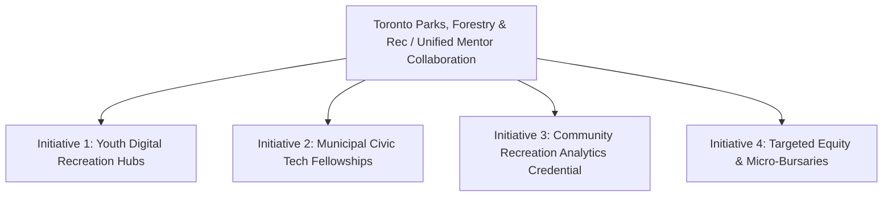

# Executive Briefing & Policy Summary for Government Stakeholders

**Project:** Learner Demographics and Course Enrollment Behavior Analysis on EduPro  
**Prepared For:** Executive Leadership, City of Toronto Government – Parks, Forestry & Recreation  
**Partnering Entity:** Unified Mentor Analytics Collaborative  
**Date:** October 2026  
**Document Purpose:** Strategic Briefing for Municipal Workforce Upskilling, Youth Digital Inclusion, and Equitable Education Planning  

---

## Executive Overview

Online learning platforms represent essential civic infrastructure for lifelong learning, workforce adaptability, and equitable economic inclusion. The **EduPro** platform serves as an operational benchmark for digital skill acquisition, currently engaging **2,017 verified learners** across **4,228 course enrollments** in high-demand technical, managerial, and civic disciplines.

This executive summary translates findings from the foundational empirical research paper into **actionable policy intelligence** tailored specifically for the **City of Toronto Government Parks, Forestry & Recreation** division and institutional partners at **Unified Mentor**. Rather than relying on intuition or passive platform growth, this analysis provides an evidence-based roadmap to align municipal learning initiatives with actual citizen behaviors, demographics, and skill needs.

---

## Key Performance Indicators (KPI) Scorecard

| Metric | Measured Value | Benchmark / Health Status | Stakeholder Significance |
| :--- | :---: | :---: | :--- |
| **Total Registered Learners** | **2,017** | Active Civic Population | Represents broad public adoption across post-secondary & working cohorts. |
| **Total Course Transactions** | **4,228** | Healthy Engagement Density | Strong course uptake averaging **2.10 courses per citizen**. |
| **Gender Inclusivity Ratio** | **1.037 : 1 (F:M)** | **Parity Achieved** (50.9% F / 49.1% M) | Excellent baseline equity; exceeds typical tech platform benchmarks. |
| **Youth Participation (<18)** | **15.12% (305 users)** | Growth Opportunity | 68.5% concentrated in beginner coursework; prime target for youth centers. |
| **Working Professionals (26–35)**| **48.24% (973 users)** | Core Demographic | Accounts for **53.57% of all platform enrollments** and 74.6% of advanced tracks. |
| **Technical Domain Share** | **64.29%** | High Market Relevance | Overwhelming demand for AI, Software Engineering, and Cybersecurity. |

---

## 4 Strategic Empirical Findings for Civic Decision-Makers

```
Key Metric Visual Summary:
  Age Breakdown:         [15% Youth <18]  [37% Young Adults 18-25]  [48% Working Professionals 26-35]
  Enrollment Share:      [11% Youth]      [35% Young Adults]        [54% Working Professionals]
  Platform Gender Split: [50.9% Female]   [49.1% Male]
  Top Disciplines:       Data Science (23%) | Software Dev (22%) | Cybersecurity (20%) | Business (13%)
```

### 1. Robust Platform-Wide Gender Parity with Domain-Specific Nuances
* **Finding:** At the aggregate level, EduPro demonstrates an exemplary gender balance (**50.92% female vs. 49.08% male**).
* **Nuance:** When disaggregated by domain, female learners significantly lead in **Digital Design & UX (14.9% vs. 9.2%)**, **Data Science & AI (24.9% vs. 20.6%)**, and **Public Sector & Healthcare Informatics (11.5% vs. 8.8%)**, while male learners show higher concentration in **Cybersecurity (23.9% vs. 15.3%)** and **Software Development (24.4% vs. 19.5%)**.
* **Policy Takeaway:** Municipal interventions do not need general female recruitment campaigns; instead, programs should specifically target **cross-disciplinary pathways**—such as *Women in Cybersecurity and Cloud Infrastructure* fellowships.

### 2. Working Professionals Are the Engine of Advanced Skill Acquisition
* **Finding:** Adults aged 26–35 represent 48.24% of the learner base but generate **53.57% of total enrollments**, averaging 2.33 courses per user.
* **Skill Depth:** Over **74.6% of all advanced-level course completions** originate from this professional cohort.
* **Policy Takeaway:** Mid-career residents are actively turning to digital platforms for re-skilling. Subsidizing professional certification tracks directly supports economic mobility and fills municipal tech vacancies.

### 3. Adolescent Learners Require Structured Scaffolding Beyond Beginner Gates
* **Finding:** Learners under 18 represent 15.12% of the user base but only 11.26% of transactions, averaging 1.56 courses per learner. **68.49% of youth enrollments are at the beginner level**, with only 5.25% reaching advanced coursework.
* **Policy Takeaway:** High school students are eager to explore (favoring Software Development and Creative Media), but lack the scaffolding or peer support needed to transition into intermediate/advanced technical competencies on their own.

### 4. Untapped Potential in Civic Technology and Community Recreation Management
* **Finding:** Courses within the *Public Sector Analytics & Health Informatics* category—including *Community Recreation Planning & Management (C605)* and *Smart Cities & Public Service Operations (C603)*—currently account for 10.15% of total enrollments.
* **Policy Takeaway:** This niche represents a direct opportunity for **Parks, Forestry & Recreation** to co-brand, accredit, and fund municipal staff and community volunteers in modern data-informed recreational planning.

---

## Strategic Policy Recommendations for Toronto Parks, Forestry & Recreation



### Initiative 1: Launch "Digital Rec Rooms" in Municipal Community Centers
* **Concept:** Embed EduPro's *Web Development Fundamentals* and *UI/UX Design* curricula into after-school youth programming across Toronto community centers.
* **Target:** 500+ Toronto youth aged 15–18 annually.
* **Impact:** Provides supervised, peer-supported cohorts that bridge the gap from beginner exploration to intermediate portfolio projects, preventing adolescent drop-off.

### Initiative 2: Municipal Workforce Upskilling in Parks & Recreation Management
* **Concept:** Formally integrate EduPro's *Community Recreation Planning & Management (C605)* course into the standard professional development pathway for city recreation coordinators, park planners, and program supervisors.
* **Outcome:** Elevates data literacy across city staff, improving equitable park resource allocation and program scheduling using modern analytics.

### Initiative 3: "Women in Cyber & Cloud" Civic Bursary Program
* **Concept:** Sponsor 250 fully funded seats for female post-secondary students and career changers in EduPro's *Cybersecurity & Cloud Computing* certification track.
* **Rationale:** Directly addresses the 15.3% vs. 23.9% domain disparity identified in our chi-square analysis, creating an equitable pipeline into high-wage municipal and private cybersecurity roles.

---

## 4-Phase Implementation Roadmap

| Phase | Timeline | Key Operational Milestones | Resource Requirements |
| :--- | :--- | :--- | :--- |
| **Phase 1: Pilot Alignment** | Months 1–3 | Formalize MoU between Toronto Parks & Rec and EduPro/Unified Mentor; audit recreation curriculum alignment. | Committee leadership; curriculum review team. |
| **Phase 2: Community Hub Launch** | Months 4–6 | Deploy pilot "Digital Rec Rooms" in 5 priority neighborhood community centers; onboard 150 youth. | Hardware access in recreation centers; student mentors. |
| **Phase 3: Staff Credentialing** | Months 7–9 | Enroll 100 municipal recreation coordinators in the *Community Recreation Planning & Management* track. | Internal HR training allocation; platform enterprise licenses. |
| **Phase 4: City-Wide Expansion** | Months 10–12 | Review KPI outcomes; expand youth access city-wide; publish annual civic learner intelligence report. | Executive reporting; joint funding renewal. |

---

## Conclusion & Next Steps

The empirical data from EduPro proves that citizens are actively seeking accessible, modular, and career-relevant education. By capitalizing on the platform's high baseline gender parity and strong working professional engagement, the **City of Toronto Government Parks, Forestry & Recreation** can forge a model public-private civic learning ecosystem that empowers youth, upskills civil servants, and champions equitable digital prosperity.

*For interactive exploration of the live data, demographic distributions, and course cross-tabulations, refer to the accompanying EduPro Analytics Streamlit Dashboard (`app.py`).*
