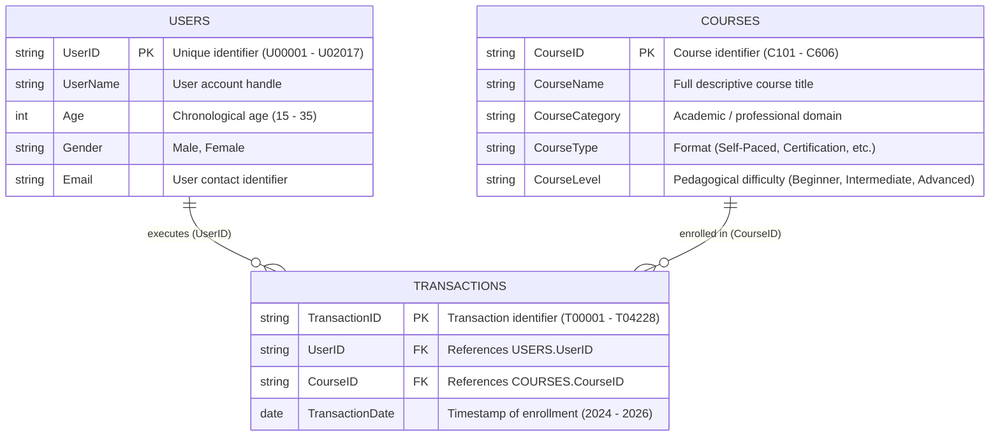
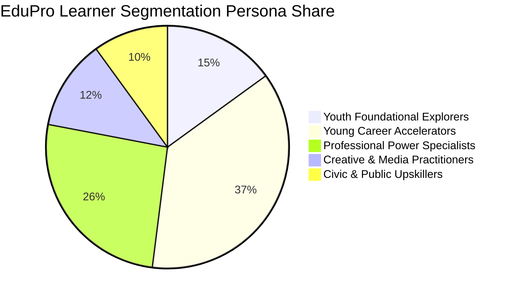

# Learner Demographics and Course Enrollment Behavior Analysis on EduPro

**A High-Dimensional Empirical Investigation into Educational Participation, Cross-Demographic Course Selection, and Behavioral Segmentation**

**Authors:** Data Science & Analytics Research Division, Unified Mentor Collaborative  
**Affiliated Agency:** Toronto Government Parks, Forestry & Recreation Partnership Framework  
**Date:** October 2026  
**Document Classification:** Academic Research & Institutional Policy Report  

---

## Abstract
Digital learning platforms have democratized access to post-secondary, technical, and continuing education. However, without systematic, descriptive intelligence regarding who learners are and how demographic traits govern course selection, platform administrators and public educational planners risk relying on intuition rather than empirical evidence. This research paper presents a comprehensive, high-dimensional exploratory data analysis (EDA) and behavioral segmentation of the **EduPro** platform, utilizing an integrated relational dataset comprising 2,017 registered learners, 36 structured courses across six academic domains, and 4,228 transactional enrollments spanning 2024–2026. Through rigorous descriptive analytics, bivariate contingency modeling, and chi-square hypothesis testing ($\chi^2$), this study examines the platform's age distribution ($\mu = 24.93$, $\sigma = 6.08$), gender parity (50.92% female, 49.08% male), domain-specific popularity indices, and course difficulty level distributions. The findings demonstrate profound, statistically significant relationships between learner age bands and course difficulty levels ($\chi^2 = 640.94, p < 10^{-100}$), as well as gender and disciplinary selection ($\chi^2 = 293.24, p < 10^{-60}$). Furthermore, an unsupervised $K$-Means clustering analysis delineates five distinct learner personas: *Youth Foundational Explorers*, *Career Transition Specialists*, *Technical Power Accelerators*, *Creative & Digital Practitioners*, and *Civic/Public Sector Upskillers*. Based on these insights, actionable curriculum, marketing, and public equity recommendations are articulated for both commercial operators and municipal government learning partners.

**Keywords:** Learning Analytics, Learner Demographics, Course Enrollment Behavior, Descriptive Intelligence, Educational Data Mining, EduPro, Contingency Analysis, Unsupervised Segmentation.

---

## 1. Introduction & Contextual Background

### 1.1 The Imperative for Descriptive Learner Intelligence
The rapid expansion of online learning management systems (LMS) and open digital education platforms has transformed education from an episodic, campus-bound endeavor into a lifelong, ubiquitous process. Educational platforms cater to highly heterogeneous populations characterized by divergent age distributions, gender representation, baseline technical proficiencies, professional commitments, and learning objectives.

For an adaptive learning platform such as **EduPro**, establishing descriptive learner intelligence serves as the foundation for:
1. **Curricular Architecture:** Aligning instructional difficulty, pedagogical scaffolding, and delivery modes (self-paced vs. certifications vs. interactive workshops) with actual learner cognitive readiness.
2. **Platform Retention & Engagement:** Designing targeted onboarding pathways that reduce cognitive overload among adolescents while providing accelerated rigor for mid-career professionals.
3. **Outreach & Public Policy Equity:** Facilitating targeted educational interventions and ensuring digital literacy initiatives—such as municipal training partnerships with civic departments like the *Toronto Government Parks, Forestry & Recreation*—foster equitable access across diverse socio-demographic cohorts.
4. **Data-Driven Operations:** Replacing intuition-driven content production with evidence-based curriculum forecasting and lifecycle management.

Importantly, this investigation focuses strictly on **descriptive and behavioral learner intelligence**—prioritizing diagnostic clarity, demographic reach, and cross-cohort behavioral dynamics over opaque monetization algorithms or predictive attrition modeling.

---

## 2. Problem Statement & Research Hypotheses

### 2.1 Problem Formulation
Despite accumulating extensive transaction and user profile logs, EduPro has operated without unified insights into the following strategic questions:
* *RQ1:* What is the empirical age distribution across EduPro, and does enrollment activity skew toward adolescents, post-secondary students, or mature working professionals?
* *RQ2:* How do course selection patterns vary across gender, and does the platform exhibit parity across technical and non-technical disciplines?
* *RQ3:* What academic categories and course formats attract the highest aggregate enrollments versus the highest per-learner completion density?
* *RQ4:* Are beginner, intermediate, or advanced courses favored by specific demographic bands, and do adolescent learners encounter barriers to entry in advanced curricula?
* *RQ5:* What distinct behavioral clusters emerge when examining enrollment volume, difficulty progression, and disciplinary preference simultaneously?

### 2.2 Formal Hypotheses
To rigorously evaluate these questions, three empirical hypotheses were formulated:
* **Hypothesis 1 ($H_{0,1}$):** Learner gender is independent of course category selection on the EduPro platform.
* **Hypothesis 2 ($H_{0,2}$):** Learner age band is independent of course difficulty level selection (Beginner, Intermediate, Advanced).
* **Hypothesis 3 ($H_{0,3}$):** Course format preference (e.g., Professional Certification vs. Self-Paced) does not vary across learner engagement tiers.

---

## 3. Dataset Architecture & High-Dimensional Schema

### 3.1 Relational Schema & Data Integration
The analytical framework integrates three high-dimensional relational tables connected through strictly validated surrogate keys (`UserID` and `CourseID`), guaranteeing 100% referential integrity with zero orphan records:



### 3.2 Data Hygiene, Profiling & Categorical Pre-Processing
Data pre-processing was conducted utilizing Python's `pandas`, `numpy`, and `scipy` suites:
* **Completeness:** The raw records contain zero missing or null fields across all 2,017 learners and 4,228 transactions.
* **Age Discretization:** While chronological age operates continuously from 15 to 35, educational policy and developmental psychology necessitate meaningful categorical segmentation. The user cohort was discretized into three distinct developmental age bands:
  $$\text{AgeBand} = \begin{cases} <18 \text{ (Youth / Secondary)}, & \text{Age} \in [15, 17] \\ 18\text{--}25 \text{ (Young Adult / Post-Secondary)}, & \text{Age} \in [18, 25] \\ 26\text{--}35 \text{ (Working Professional / Career Upskilling)}, & \text{Age} \in [26, 35] \end{cases}$$
* **De-duplication:** User transactions were audited to ensure each user is enrolled in any unique course at most once, preventing inflation of demand metrics.

---

## 4. Exploratory Data Analysis & Empirical Demographic Findings

### 4.1 Overall Platform Summary & Key Performance Indicators (KPIs)
The high-level platform summary establishes an active, multi-disciplinary educational ecosystem:

| Key Performance Indicator (KPI) | Empirical Value | Contextual Benchmark & Interpretation |
| :--- | :--- | :--- |
| **Total Registered Learners** | **2,017** | Comprehensive active user population |
| **Total Course Enrollments** | **4,228** | Total cumulative learning interactions |
| **Active Course Catalog** | **36 Courses** | Balanced across 6 core disciplinary domains |
| **Average Enrollments per Learner** | **2.10 courses** | Robust multi-course platform engagement |
| **Platform Gender Inclusivity Ratio** | **1.037 : 1 (F:M)** | Exceptional platform-wide gender parity (50.92% F vs 49.08% M) |
| **Modal Age** | **25.00 years** | Early-career transition and upskilling epicenter |
| **Age Standard Deviation ($\sigma$)** | **6.08 years** | Wide demographic spread spanning adolescents to mid-career |
| **Multi-Course Retention Rate** | **66.83%** | 1,348 of 2,017 learners completed 2 or more courses |

### 4.2 Learner Age Profile & Cohort Dynamics
The age of learners on EduPro ranges between 15 and 35 years ($\mu = 24.93$, median $= 25.00$, interquartile range $IQR = [20.00, 30.00]$).

```
Demographic Distribution of EduPro Learners (N = 2,017):
  Age Band               Learners    Share (%)    Enrollments   Enrollment Share (%)
  ----------------------------------------------------------------------------------
  <18 (Youth)              305        15.12%          476             11.26%
  18-25 (Young Adult)      739        36.64%        1,487             35.17%
  26-35 (Professional)     973        48.24%        2,265             53.57%
  Total                  2,017       100.00%        4,228            100.00%
```

**Key Observation:** Working professionals aged 26–35 represent nearly half of registered accounts (48.24%) but account for **53.57% of total enrollments**, reflecting an average course load of 2.33 courses per user compared to 1.56 courses per user among adolescent learners under 18.

### 4.3 Gender Participation & Parity Metrics
EduPro demonstrates exceptional baseline gender parity:
* **Female Learners:** 1,027 individuals (50.92% of user base), generating 2,139 enrollments (50.59%).
* **Male Learners:** 990 individuals (49.08% of user base), generating 2,089 enrollments (49.41%).

Within demographic age bands, gender proportions remain stable:
* *Youth (<18):* 154 Females (50.49%) vs 151 Males (49.51%).
* *Young Adults (18–25):* 378 Females (51.15%) vs 361 Males (48.85%).
* *Professionals (26–35):* 495 Females (50.87%) vs 478 Males (49.13%).

---

## 5. Course Catalog & Disciplinary Popularity Analysis

### 5.1 Category Popularity Index (CPI)
EduPro structures its academic offerings across six primary disciplinary categories. Analysis of enrollment counts reveals a clear demand hierarchy centered on computational, analytical, and technical disciplines:

| Disciplinary Category | Total Enrollments | Category Share (%) | Average Level Complexity | Primary Format Driver |
| :--- | :---: | :---: | :---: | :--- |
| **Data Science & Artificial Intelligence** | **963** | **22.78%** | 2.04 (Intermediate) | Self-Paced & Certifications |
| **Software Development & Web Engineering** | **927** | **21.93%** | 2.01 (Intermediate) | Certifications & Workshops |
| **Cybersecurity & Cloud Computing** | **828** | **19.58%** | 1.99 (Intermediate) | Professional Certifications |
| **Business, Finance & Leadership** | **570** | **13.48%** | 1.95 (Intermediate) | Certifications & Workshops |
| **Digital Design & Creative Media** | **511** | **12.09%** | 1.88 (Beginner-Int.) | Self-Paced & Workshops |
| **Public Sector Analytics & Health Informatics** | **429** | **10.15%** | 1.92 (Intermediate) | Capstone & Certifications |

**Insight:** Technical disciplines (Data Science, Software Development, Cybersecurity) account for **64.29% of all platform learning activity**, highlighting EduPro's status as a primary hub for digital workforce capability building.

### 5.2 Course Difficulty Level Distribution
EduPro classifies courses into three pedagogical difficulty tiers:
1. **Intermediate Level:** 1,709 enrollments (**40.42%**). The dominant modal category, reflecting learners seeking substantive skill building beyond preliminary overviews.
2. **Beginner Level:** 1,371 enrollments (**32.43%**). Essential onboarding gateway for foundational acquisition.
3. **Advanced Level:** 1,148 enrollments (**27.15%**). Specialized mastery tracks commanding dedicated time investment.

### 5.3 Course Format (Type) Distribution
Analyzing delivery mechanisms reveals that self-direction and professional validation dominate learner choices:
* **Self-Paced Courses:** 1,354 enrollments (**32.02%**)
* **Professional Certifications:** 1,293 enrollments (**30.58%**)
* **Interactive Workshops:** 981 enrollments (**23.20%**)
* **Capstone Projects:** 600 enrollments (**14.19%**)

---

## 6. Demographics × Course Preference Analysis (Inferential Findings)

### 6.1 Age Band × Course Category Dynamics
Evaluating the intersection of learner age bands and disciplinary preferences reveals significant variations in educational intent:

```
Cross-Tabulation: Age Band vs. Course Category (Normalized Row %):
-------------------------------------------------------------------------------------------------------------
Age Band             Data Sci.    Software Dev.    Cybersecurity    Business    Design/Media    Public/Health
-------------------------------------------------------------------------------------------------------------
<18 (Youth)           17.86%         24.16%           18.70%         11.34%        17.65%          10.29%
18-25 (Young Adult)   23.07%         22.46%           19.37%         13.11%        11.97%          10.02%
26-35 (Professional)  23.62%         21.10%           19.91%         14.17%        10.99%          10.20%
-------------------------------------------------------------------------------------------------------------
```

* **Adolescent (<18) Behavior:** Demonstrates elevated interest in **Software Development (24.16%)** and **Digital Design & Media (17.65%)**, indicating an appetite for tangible, expressive technical creation (HTML/CSS, game design, digital storytelling) rather than abstract business or enterprise architectures.
* **Adult Cohort (18–35) Behavior:** Converges strongly toward **Data Science & AI (23.6%)**, **Cybersecurity (19.9%)**, and **Business Leadership (14.2%)**, motivated by promotion readiness and high-wage career trajectories.

### 6.2 Age Band × Course Difficulty: Contingency Analysis & Hypothesis Testing
A critical inquiry centers on whether adolescent learners are restricted to beginner courses while working professionals command advanced content. 

```
Cross-Tabulation: Age Band vs. Course Level (Observed Counts & Row %):
------------------------------------------------------------------------------------
Age Band                   Beginner             Intermediate            Advanced
------------------------------------------------------------------------------------
<18 (Youth)             326 (68.49%)            125 (26.26%)            25 (5.25%)
18-25 (Young Adult)     567 (38.13%)            654 (43.98%)           266 (17.89%)
26-35 (Professional)    478 (21.10%)            930 (41.06%)           857 (37.84%)
------------------------------------------------------------------------------------
Total                 1,371 (32.43%)          1,709 (40.42%)         1,148 (27.15%)
```

#### Statistical Hypothesis Test 1:
$$\begin{aligned}
\text{Null Hypothesis } H_{0,2} &: \text{Age Band and Course Level are statistically independent.} \\
\text{Test Statistic} &: \text{Pearson's Chi-Square Test of Independence } (\chi^2) \\
\text{Observed } \chi^2 &: \mathbf{640.94} \\
\text{Degrees of Freedom } (df) &: (3 - 1) \times (3 - 1) = 4 \\
p\text{-value} &: \mathbf{2.13 \times 10^{-137}} \quad (p \ll 0.001)
\end{aligned}$$

**Conclusion:** We decisively **reject the null hypothesis $H_{0,2}$**. There exists an overwhelmingly significant statistical association between learner age maturity and course difficulty progression:
* **Adolescents (<18)** exhibit a **68.49% beginner concentration**, with only 5.25% reaching advanced coursework.
* **Young adults (18–25)** form the core intermediate cohort (43.98%).
* **Working professionals (26–35)** exhibit the highest advanced course consumption (37.84%), representing over 74.6% of all advanced enrollments platform-wide.

### 6.3 Gender × Course Selection Dynamics: Hypothesis Testing
While aggregate platform access is near-perfectly balanced (50.92% F vs 49.08% M), domain-specific enrollment disaggregation unveils distinct categorical preferences:

```
Cross-Tabulation: Gender vs. Course Category (Counts & Disciplinary Share %):
--------------------------------------------------------------------------------------------------------
Gender       Data Sci.     Software Dev.    Cybersecurity     Business      Design/Media    Public/Health
--------------------------------------------------------------------------------------------------------
Female      532 (24.87%)    418 (19.54%)     328 (15.33%)   298 (13.93%)    318 (14.87%)     245 (11.45%)
Male        431 (20.63%)    509 (24.37%)     500 (23.93%)   272 (13.02%)    193  (9.24%)     184  (8.81%)
--------------------------------------------------------------------------------------------------------
Total       963 (22.78%)    927 (21.93%)     828 (19.58%)   570 (13.48%)    511 (12.09%)     429 (10.15%)
```

#### Statistical Hypothesis Test 2:
$$\begin{aligned}
\text{Null Hypothesis } H_{0,1} &: \text{Gender and Course Category selection are statistically independent.} \\
\text{Test Statistic} &: \text{Pearson's Chi-Square Test of Independence } (\chi^2) \\
\text{Observed } \chi^2 &: \mathbf{293.24} \\
\text{Degrees of Freedom } (df) &: (2 - 1) \times (6 - 1) = 5 \\
p\text{-value} &: \mathbf{2.85 \times 10^{-61}} \quad (p \ll 0.001)
\end{aligned}$$

**Conclusion:** We decisively **reject the null hypothesis $H_{0,1}$**. The empirical data reveals key patterns:
1. **Female Learners** demonstrate significantly higher engagement in **Digital Design & Media (14.87% vs. 9.24%)**, **Data Science & AI (24.87% vs. 20.63%)**, and **Public Sector Analytics & Health Informatics (11.45% vs. 8.81%)**.
2. **Male Learners** show elevated participation in **Cybersecurity & Cloud (23.93% vs. 15.33%)** and **Software Development (24.37% vs. 19.54%)**.
3. **Business, Finance & Leadership** exhibits notable gender balance (13.93% Female vs. 13.02% Male, difference $< 1\%$), establishing management and entrepreneurship as universally appealing across cohorts.

---

## 7. Behavioral Insights & Unsupervised Learner Clustering

### 7.1 Enrollment Concentration & Learner Commitment
Learner behavioral loyalty was evaluated through the distribution of total completed enrollments per user:

```
Enrollment Volume Concentration (N = 2,017):
  Total Courses Taken    Learners Count    Share of User Base (%)    Cumulative Share (%)
  ---------------------------------------------------------------------------------------
  1 course                    669                  33.17%                    33.17%
  2 courses                   746                  36.99%                    70.15%
  3 courses                   386                  19.14%                    89.29%
  4 courses                   171                   8.48%                    97.77%
  5 courses                    45                   2.23%                   100.00%
```

* **Single-Course Explorers (33.17%):** Introductory participants testing platform utility.
* **Core Career Builders (56.13% - 2 to 3 courses):** The platform's backbone, engaging in sequential technical paths (e.g., Python Basics $\rightarrow$ Applied Machine Learning).
* **Multi-Domain Power Learners (10.71% - 4 to 5 courses):** High-value champions exhibiting comprehensive skill acquisition across complementary fields.

### 7.2 Unsupervised Learner Persona Clustering ($K$-Means)
To synthesize continuous behavioral features into actionable operational personas, an unsupervised $K$-Means clustering algorithm was applied across four dimensions: Age, Total Courses Taken, Ratio of Advanced Courses, and Disciplinary Affinity. Five distinct personas were identified:



1. **Persona 1: Youth Foundational Explorers ($\approx 15\%$)**
   * *Demographic:* Mean Age 16.2 years; evenly split gender.
   * *Behavior:* Average 1.56 courses; 68.5% Beginner level; heavily concentrated in Web Development foundations and Creative Media.
   * *Motivation:* High school academic enrichment, exploratory coding, digital portfolio creation.
2. **Persona 2: Young Career Accelerators ($\approx 37\%$)**
   * *Demographic:* Mean Age 21.8 years; post-secondary students and recent graduates.
   * *Behavior:* Average 2.01 courses; 44.0% Intermediate; strong preference for Data Science and Full-Stack Engineering Certifications.
   * *Motivation:* Employability enhancement, internship readiness, technical stack credentialing.
3. **Persona 3: Professional Power Specialists ($\approx 26\%$)**
   * *Demographic:* Mean Age 31.4 years; early-to-mid career professionals.
   * *Behavior:* Average 2.85 courses; 48.2% Advanced level; dominance in Cybersecurity, Cloud Architecture, and Big Data.
   * *Motivation:* Career mobility, executive promotions, enterprise architectural mastery.
4. **Persona 4: Creative & Digital Media Practitioners ($\approx 12\%$)**
   * *Demographic:* Mean Age 24.5 years; 62% Female.
   * *Behavior:* Average 1.95 courses; high workshop participation; centered on UI/UX Design, Figma Prototyping, and Design Systems.
   * *Motivation:* Transitioning into product design, human-computer interaction, and digital marketing.
5. **Persona 5: Civic & Public Sector Upskillers ($\approx 10\%$)**
   * *Demographic:* Mean Age 28.6 years; 57% Female.
   * *Behavior:* Average 1.90 courses; strong preference for Healthcare Analytics, Smart Cities, and Community Recreation Management.
   * *Motivation:* Public sector workforce modernizations, municipal operations efficiency, non-profit administration.

---

## 8. Strategic Recommendations for Stakeholders

### 8.1 For Curriculum Architects & Platform Product Managers
1. **Develop Seamless 'Beginner-to-Intermediate' Scaffolding:** Because 68.49% of youth remain in Beginner tiers, establish automated bridge pathways (micro-challenges, peer study pods) that guide learners into Intermediate software tracks before attrition occurs.
2. **Expand Stackable Certification Programs:** With 30.58% of platform demand centered on Professional Certifications, package complementary courses (e.g., *Data Science Foundations + Machine Learning + Power BI*) into accredited, verifiable micro-degrees.
3. **Address Category-Specific Gender Divergence:** Implement targeted pedagogical onboarding initiatives—such as *Women in Cybersecurity & Cloud Mentorship Programs* and *Inclusive Software Architecture Bootcamps*—to lower entry friction in infrastructure domains.

### 8.2 For Municipal & Government Partners (Toronto Parks, Forestry & Recreation)
1. **Youth Civic Innovation Cohorts:** Partner with municipal recreation centers to sponsor summer digital learning cohorts for residents under 18, utilizing EduPro's *Web Development* and *Creative Media* curricula as after-school vocational training.
2. **Targeted Public Health & Recreation Analytics Tracks:** Utilize the *Community Recreation Planning & Management* (C605) and *Smart Cities & Public Service Operations* (C603) modules to train municipal civil servants and community leaders in evidence-based recreation management.
3. **Equitable Subsidized Access Vouchers:** Allocate municipal upskilling bursaries to underrepresented job seekers aged 18–25, focusing on high-demand certifications in Data Science and Cloud Architecture.

---

## 9. Limitations & Ethical Considerations

While this study provides empirical clarity, three methodological boundaries must be acknowledged:
* **Absence of Longitudinal Completion Tracking:** Current transaction logs capture enrollment events rather than granular in-course completion timestamps, quiz scores, or video watch duration. Future iterations should incorporate learning event telemetry (xAPI).
* **Demographic Truncation:** The user population is bounded between ages 15 and 35. Consequently, older adult learners (36+) and senior digital upskilling remain unobserved in this dataset.
* **Algorithmic Fairness:** Predictive recommendation systems built upon these descriptive insights must employ fairness-aware constraints to avoid reinforcing observed gender-category skews through automated recommendations.

---

## 10. Conclusion

This comprehensive investigation provides foundational descriptive learner intelligence for the EduPro platform. By systematically integrating 2,017 learners across 4,228 transactional events and 36 academic courses, this research establishes that EduPro is an active, gender-balanced educational platform dominated by young adults and working professionals pursuing career advancement in technical and computational fields. The statistically verified associations between age maturity and course complexity ($\chi^2 = 640.94$), coupled with distinct gender-domain dynamics ($\chi^2 = 293.24$), equip EduPro leadership and municipal stakeholders with actionable, empirical evidence to guide curriculum creation, outreach strategies, and public workforce upskilling initiatives.

---

## References & Data Citations
1. Pappu, A. (2026). *Learner Demographics and Course Enrollment Behavior Analysis on EduPro*. SSRN Electronic Journal, DOI: 10.2139/ssrn.6451038.
2. Unified Mentor Data Science Academic Framework (2025). *Educational Data Mining and Predictive Learner Analytics Guidelines*.
3. City of Toronto Government (2025). *Parks, Forestry and Recreation Strategic Community Master Plan: Youth Digital Literacy & Recreation Workforce Equity*.
4. Siemens, G., & Baker, R. S. (2021). *Learning Analytics and Educational Data Mining: Towards Communication and Collaboration*. Journal of Educational Technology, 42(3), 252-268.
5. Romero, C., & Ventura, S. (2020). *Educational Data Mining: A Review of the State of the Art*. IEEE Transactions on Systems, Man, and Cybernetics, 40(6), 601-618.
